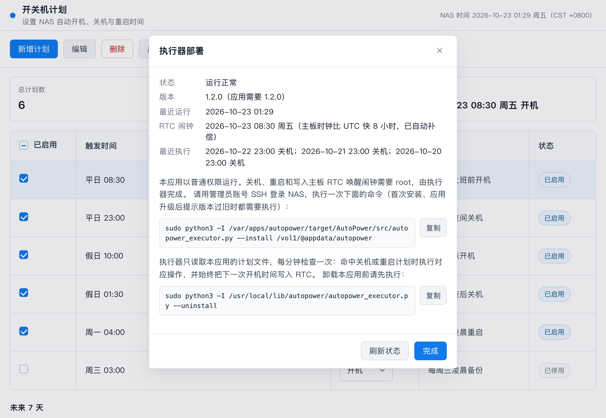

# AutoPower 自动开关机

AutoPower（自动开关机）是一个飞牛 fnOS 应用，为 NAS 设置**定时开机**、**定时关机**和**定时重启**计划：工作日早上自动开机、深夜自动关机，周末按另一套时间执行，也可以每天或每周固定时间重启。定时开机通过主板 RTC 唤醒实现，定时关机和重启由系统定时任务执行。


- 支持平台：fnOS x86、ARM（纯 Python + Bash，依赖系统自带的 `python3` 与 `curl`；x86 已实机验证，ARM 尚未实机验证）
- 主页：<https://autopower.vanjay.cn>
- 开源协议：[MIT](LICENSE)
- 更新日志：[CHANGELOG.md](CHANGELOG.md)

## 功能

- 新增、编辑、删除、启用、停用开机、关机或重启计划，计划可添加备注
- 日期支持每天、平日（周一至周五）、假日（周六、周日）和指定星期
- 首页显示下一次执行时间和未来 7 天的执行预览
- 同一时间存在不同操作（如既开机又关机、既关机又重启）、重复计划等冲突会给出提示
- 关机（包括手动关机）前自动把下一次开机时间写入主板 RTC
- 主板时钟走 UTC 或走本地时间都能正确唤醒：执行器测量 RTC 与系统时间的偏差并自动补偿
- 界面显示执行器运行状态、RTC 闹钟时间和最近的关机、重启记录

| 编辑计划 | 执行器部署 |
|---|---|
|  |  |

## 安装

1. 到 [Releases](https://github.com/wangwanjie/FN-AutoPower/releases/latest) 按 NAS 架构下载安装包：
   - Intel / AMD 处理器：`autopower-<版本>-x86.fpk`
   - ARM 处理器：`autopower-<版本>-arm.fpk`

   不确定架构时，SSH 登录 NAS 执行 `uname -m`：输出 `x86_64` 选 x86，输出 `aarch64` 选 ARM。可以用同一 Release 中的 `SHA256SUMS.txt` 校验文件完整性。
2. 在飞牛「应用中心 → 手动安装」上传安装包。
3. 打开应用，点「执行器部署」，复制部署命令，用管理员账号 SSH 登录 NAS 执行一次（见下文）。
4. 在 BIOS/UEFI 中开启 RTC 唤醒（不同主板叫 “Resume by RTC Alarm”、“Wake on RTC” 等）。定时关机和重启不依赖这一步。

## 执行器部署

应用本身以普通权限运行，只负责编辑计划。关机、重启和写主板 RTC 闹钟需要 root，由一个独立的执行器完成，需要管理员部署一次：

```bash
sudo python3 -I /var/apps/autopower/target/AutoPower/src/autopower_executor.py --install <数据目录>
```

实际命令以应用内「执行器部署」中显示的为准（数据目录因安装卷而异）。部署后：

- `/usr/local/lib/autopower/`：执行器代码的 root 所有副本，cron 不直接运行应用目录中可被修改的代码
- `/etc/cron.d/autopower`：每分钟运行一次执行器，命中关机计划时执行 `/sbin/poweroff`、命中重启计划时执行 `/sbin/reboot`，并同步 RTC 唤醒闹钟
- `/etc/systemd/system/autopower-rtc-wake.service`：关机、重启前写入下一次开机时间
- `/var/lib/autopower/status.json`：执行器运行状态，供应用界面显示

应用升级后如果界面提示“执行器版本过旧”，重新执行一次部署命令即可。

卸载应用前先卸载执行器：

```bash
sudo python3 -I /usr/local/lib/autopower/autopower_executor.py --uninstall
```

没有执行时，执行器发现应用数据目录被删除后也会自动停止关机、重启并清除 RTC 闹钟。

## 安全设计

- 应用以包用户运行（`config/privilege` 为 `run-as: package`），不写入任何系统文件
- 执行器只做关机、重启和写 RTC 三件事，只调用固定路径的 `/sbin/poweroff`、`/sbin/reboot`，不执行任何来自配置的命令；计划文件按白名单逐条校验，拒绝符号链接并限制大小
- 后端只监听 `127.0.0.1:3868`，唯一入口 `/cgi/ThirdParty/autopower/index.cgi/` 走飞牛登录鉴权，内网和公网访问都无需额外端口或反代（详见 [docs/REMOTE-ACCESS.md](docs/REMOTE-ACCESS.md)）
- 写接口只接受 `application/json`，阻止跨站表单提交；请求体限制 64KB
- 不访问外网，不收集任何数据

## 开发

### 技术栈

- 后端：Python 3 标准库 HTTP server，不依赖第三方包
- 前端：原生 HTML/CSS/JavaScript
- 调度核心：纯 Python 计划校验、下次触发时间计算、冲突检测
- 打包：fnOS `fnpack`
- 测试：Python `unittest`

### 目录结构

```text
src/autopower_core.py        计划校验、下次触发计算、冲突检测、RTC 偏差换算
src/autopower_server.py      应用后端（包用户运行），提供 /api
src/autopower_executor.py    root 执行器：关机、重启、写 RTC、部署与卸载
web/                         前端页面
tests/                       单元测试
fpk/                         fnOS FPK 包模板
docs/images/                 README 与上架截图
docs/STORE-SUBMISSION.md     飞牛应用中心上架材料与自查清单
scripts/sync-fpk.sh          同步 src、web 到 fpk 包模板
scripts/check-fpk.sh         打包前自检（manifest、图标、JSON、生命周期脚本、代码同步、单元测试）
scripts/build-fpk.sh         自检并按平台构建 .fpk
scripts/build-store.sh       汇总上架材料到 store/（构建产物，不提交）
scripts/demo-server.py       带示例数据的演示服务（不读写系统文件）
scripts/capture-screenshots.mjs  用无头 Chrome 重新生成 docs/images 下的截图
scripts/create-icons.py      重新生成图标（需要 Pillow，仅改图标设计时运行）
scripts/publish_site.sh      把 site/ 作为单个提交强推到 gh-pages 分支（GitHub Pages）
site/                        项目主页（https://autopower.vanjay.cn）
design/                      OpenDesign 参考稿
```

### 本地运行

```bash
python3 src/autopower_server.py --host 127.0.0.1 --port 3868 --data-dir /tmp/autopower-dev --web-dir web
```

打开 `http://127.0.0.1:3868/`。本地没有部署执行器，界面会提示“执行器尚未部署”，这是预期行为。想看完整状态时运行演示服务：

```bash
python3 scripts/demo-server.py
```

打开 `http://127.0.0.1:3869/`。修改界面后重新生成截图（需要本机安装 Chrome，可用 `CHROME_BIN` 指定路径）：

```bash
node scripts/capture-screenshots.mjs
```

### 测试

```bash
python3 -m unittest discover -s tests -v
node --check web/app.js
```

### 打包

确认 `fnpack` 已在 PATH 中（或放在项目根目录、或设置 `FNPACK_BIN`）。构建 manifest 当前版本的 x86 与 ARM 安装包（会先同步代码并执行 `scripts/check-fpk.sh` 自检）：

```bash
./scripts/build-fpk.sh
```

指定版本或平台：

```bash
FPK_VERSION=1.3.0 FPK_PLATFORMS="x86 arm" ./scripts/build-fpk.sh
```

产物输出到 `dist-fpk/`：

```text
dist-fpk/autopower-<version>-x86.fpk
dist-fpk/autopower-<version>-arm.fpk
dist-fpk/autopower-<version>-SHA256SUMS.txt
```

各平台安装包内容相同，只有 manifest 的 `platform` 字段不同；构建过程中临时改写 `platform`，结束后自动恢复。修改版本时同步更新 manifest 的 `changelog` 字段和 `CHANGELOG.md`。

### 发布

```bash
gh release create v<version> dist-fpk/autopower-<version>-*.fpk dist-fpk/autopower-<version>-SHA256SUMS.txt --title "AutoPower <version>" --notes-file <说明文件>
```

### 主页

`site/` 是静态主页（无构建步骤），本地预览：

```bash
python3 -m http.server 8000 -d site
```

提交后发布到 GitHub Pages（把 HEAD 中的 `site/` 作为单个提交强推到 `gh-pages`；`DRY_RUN=1` 只生成提交不推送）：

```bash
./scripts/publish_site.sh
```

### fnOS 安装与刷新

如果覆盖安装后桌面入口没有刷新，可以在 fnOS 上执行：

```bash
systemctl restart trim_app_center.service
```

## 界面参考

OpenDesign 参考稿来自 `design/fnos-power-schedule-flows.html`：


